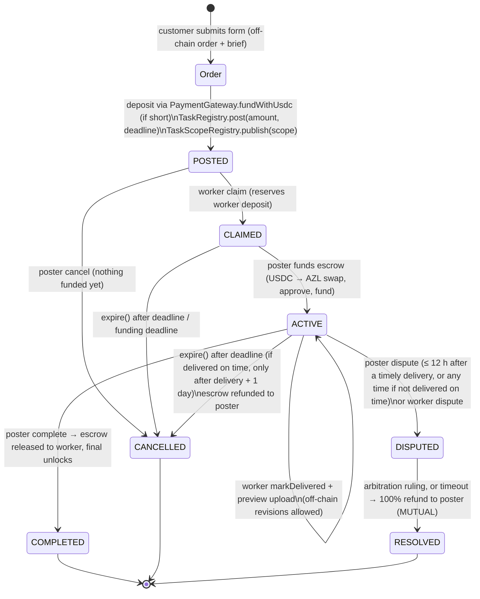

# Architecture

## Pieces

```
src/config/service.mjs            → which service is active (one import)
src/config/services/*.mjs         → service configs (default.mjs = neutral)
src/config/base-8453-*-pinned.json→ pinned AZZLE v2 manifests (micro, standard); all addresses come from here
src/lib/azzle-core.mjs            → ABIs, quote, readiness, task actions, scope builder (browser + Node)
src/lib/cost-math.mjs             → checkout numbers (pure)
src/lib/swap-core.mjs             → USDC→AZL via Uniswap v4 Universal Router + escrow funding calls
src/lib/wallet-core.mjs           → deposit balances / withdrawable / withdraw call
src/lib/server/*                  → storage drivers, order store, brief builder, previews, notifier, chain sync
src/app/order, src/app/order/[id] → customer flow and status page
src/app/ops, src/app/api/ops/*    → operator dashboard + endpoints (OPS_TOKEN)
tools/worker.mjs                  → agent CLI (claim, deliver), dry-run by default
```

Orders live off-chain in storage (JSON per order plus blobs). The chain is the source of truth for money:
the site reads tasks from the TaskRegistry and caches a snapshot on the order (`order.chain`), refreshed on
page loads, by ops actions and by the daily cron (`/api/cron/sync`).

## Escrow lifecycle



Rules this template relies on (encoded in `taskActions()` in `azzle-core.mjs`):

- Nobody can move escrowed AZL without the poster's `complete`, an arbitration ruling, or expiry.
- `expire()` (callable by anyone once allowed) ends the task as CANCELLED and refunds the escrow to the poster.
- There is **no auto-release**: a delivered task stays ACTIVE until the poster approves, disputes or it expires.
- Poster dispute window after a timely delivery: `POSTER_DISPUTE_GRACE_WINDOW` = 43200 s (12 h).
- Expiry after a timely delivery additionally waits `DELIVERY_GRACE_WINDOW` = 86400 s (1 day).
- A dispute that times out without a ruling refunds the poster 100% (`arbitration.timeout`, resolution MUTUAL).
- `deadlineDays` from the service config sets the on-chain deadline.

## Scope (on-chain description of the order)

`TaskScopeRegistryV2.publish(taskId, scope)` stores a JSON string built by `buildScope()`:

```json
{ "app": "<appTag>", "v": 1, "kind": "<kind>", "order": "<order id>",
  "fields": { "<public field>": "…" }, "privateKeccak": "0x…", "deliver": "<scopeHint>" }
```

Only fields marked `public: true` appear in clear text. All private values are hashed together
(`privateKeccak`); the plaintext stays in storage and reaches the worker only through `brief` (OPS_TOKEN).
`appTag` is how the indexer, CLI and cron find this shop's tasks; never change it after real orders exist.

## Money flow

1. **Booking deposit (poster).** AZZLE requires every poster to hold a deposit in the market's
   `AgentDepositVaultV2`: an entry floor plus a reserve per live task, plus an **access fee** charged when the
   task is posted. If the wallet's available deposit is short, the checkout tops it up with
   `PaymentGateway.fundWithUsdc` (USDC → AZL inside the gateway). The fee is waived when the poster has an
   AZZLE Action Credit (`stakingVault.stakingActive() && creditsOf(poster) > 0`).
2. **Escrow (poster → worker).** The service price in USD is converted to AZL at the live oracle quote
   (`quoteUsd`), the customer's USDC is swapped to AZL on the Uniswap v4 AZL pool, approved to the
   `escrowVault` and `fund`ed. On `complete`, escrow is released to the worker.
3. **Worker deposit.** Claiming reserves part of the worker's own deposit (same vault rules), released when the
   task ends. A worker can top up with `fundWithEth` / `fundWithUsdc`.
4. **Withdraw (wallet modal).** `available = deposits − reserved`; while a task is live the entry floor also
   stays put, so `withdrawable = available − floor` (else `available`). `withdraw(amount, to)` sends AZL back to
   the wallet. The access fee is never refunded.

## Cost math (`src/lib/cost-math.mjs`)

- Deposit top-up = **130%** of the collateral shortfall (cushion for oracle haircut and slippage), converted at
  the quote and **rounded up to whole cents** of USDC; `minAzlOut` = **90%** of nominal AZL.
- Access fee shown in USD = fee AZL × quote, rounded up to cents (0 when a credit waives it).
- Refundable part = deposit today − fee. Service USDC = the live Uniswap quote for the escrow AZL
  (0 if the wallet already holds it). Total = deposit today + service USDC.
- Every number comes from live reads; while a read is missing the UI shows "…" instead of a guess.

## Base mainnet addresses (from the pinned manifests)

| Contract | micro | standard |
|---|---|---|
| taskRegistry | `0xd0dE9c0B928Fdd353213445e750a9526cBBba2B9` | `0xc59266071794210E68Be4c0CdB6D5F4CF652C300` |
| taskScopeRegistry | `0xdD8c6F7803CB46eB521960C827B52994bd35e863` | `0x2AB611C0fD3C8Cc91D1252ba99A37Fe7b977d964` |
| escrowVault | `0xfa84143a86383189Fd7a5f1a3637CD93F29441b0` | `0xA10E05505A334963C44cd63cEcd204840D5122D1` |
| depositVault | `0x64e254b99766BD163cFBAA4DAc74c1bfDFC93E82` | `0x50fE780072d62E6bc07De096B6e58a141F385D2f` |
| paymentGateway | `0xF4907910ae280767022A55C0F162eCb5B7DC7dec` | `0x16da063F3d99edB9920adeb9aaE55CfA32434e1C` |
| arbitrationModule | `0x905E561B44E76fdeAF5F41Bc2c46ebCE4E5E02fE` | `0x1003592A2eeF71b15A21457910007b38B0e2027A` |
| stakingVault | `0x7d64483fC97481043a3eF407f9DDA2a1968BA43B` | `0xc39cA289303eAb7687B9D6A17b18538b75e7246b` |
| pricingPolicy | `0xDacD261dB8952e3d18537B3a61CA6dbB9fa3FA62` | `0xB386a02d6403a088723e502dC2bb78a6B699317A` |
| usdOracle | `0xADF46968CdFAaB7298E470e475DF0DD88da02E7a` | `0xADF46968CdFAaB7298E470e475DF0DD88da02E7a` |
| reputationRegistry | `0x549eABfaF6a4dC1E47B75f93a66352cCC3bfc074` | `0xb5827Bb3bb9760Ed72eA1416818188a8e71851B6` |

Shared external contracts (same in both manifests):

| Name | Address |
|---|---|
| usdc | `0x833589fCD6eDb6E08f4c7C32D4f71b54bdA02913` |
| weth | `0x4200000000000000000000000000000000000006` |
| azl | `0x931517E9502F9d52CDF6F5AC7fca7925e2A1BBA3` |
| poolManager | `0x498581fF718922c3f8e6A244956aF099B2652b2b` |
| universalRouter | `0x6fF5693b99212Da76ad316178A184AB56D299b43` |
| ethUsdFeed | `0x71041dddad3595F9CEd3DcCFBe3D1F4b0a16Bb70` |

Deployment blocks: micro 50246451, standard 49762587. Manifest version 2.0.0.

## Storage drivers

`STORAGE_DRIVER` = `local` (files under `DATA_DIR`, dev only), `blob` (Vercel Blob, private; big uploads go
direct-to-blob via presign/commit) or `s3` (AWS/R2; optional deps). Finals are served by `/api/orders/[id]/media`
with `cache-control: private, no-store`, only after a fresh on-chain read returns `COMPLETED`.

## Notifications

`src/lib/server/notify.mjs` fans out to every configured provider (webhook, email via Resend or FormSubmit).
Events: `new` order, and once each `funded`, `delivered`, `approved`, `disputed`, detected from chain snapshots.
The webhook payload contains public data only (id, price, public fields, task id, chain snapshot) and is
HMAC-SHA256 signed when `NOTIFY_WEBHOOK_SECRET` is set. Add a provider by adding a function to `providers`.

## Hardening

- Private order fields never go on-chain or into webhooks; the public order JSON omits them.
- Order creation is validated against the field schema and rate limited per IP.
- The brief scraper is SSRF-safe: every redirect hop is re-checked against private/internal addresses, 2 MB cap.
- `/api/ops/*` require `OPS_TOKEN`; the cron requires `CRON_SECRET` (or the ops token) in production.
- Finals are gated by a fresh chain read, never by the cached snapshot.
- The site never holds a private key. Only the worker CLI signs, from a key file you point it at.
